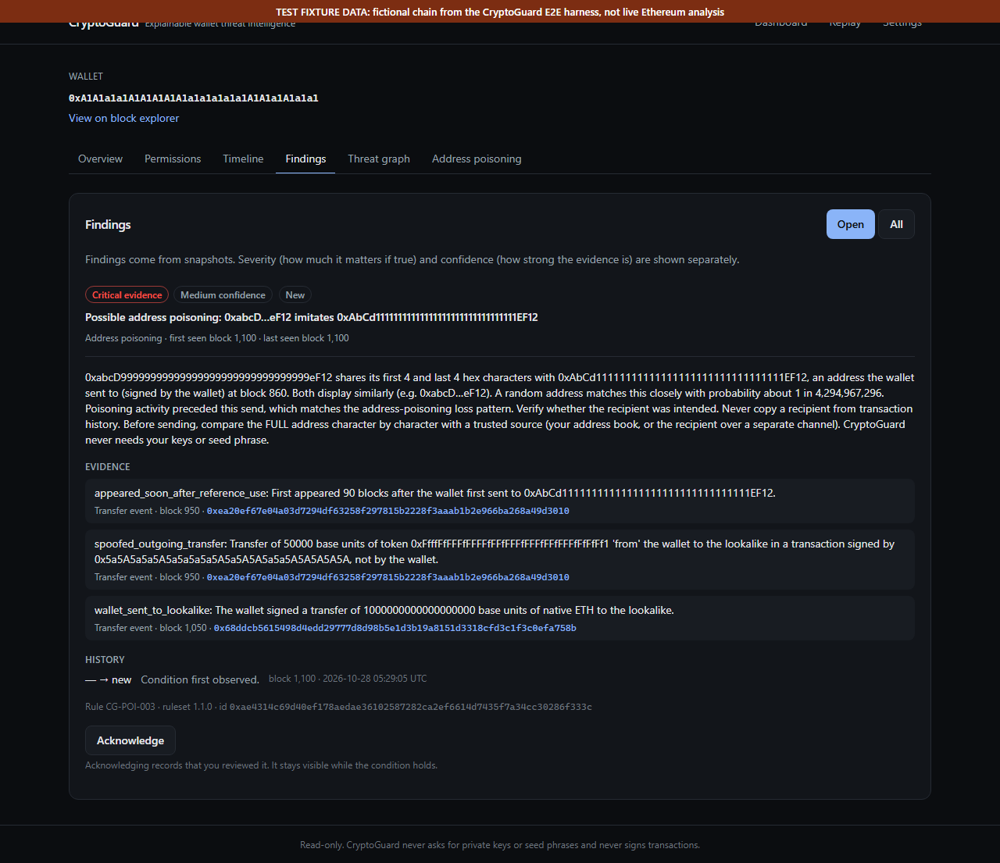
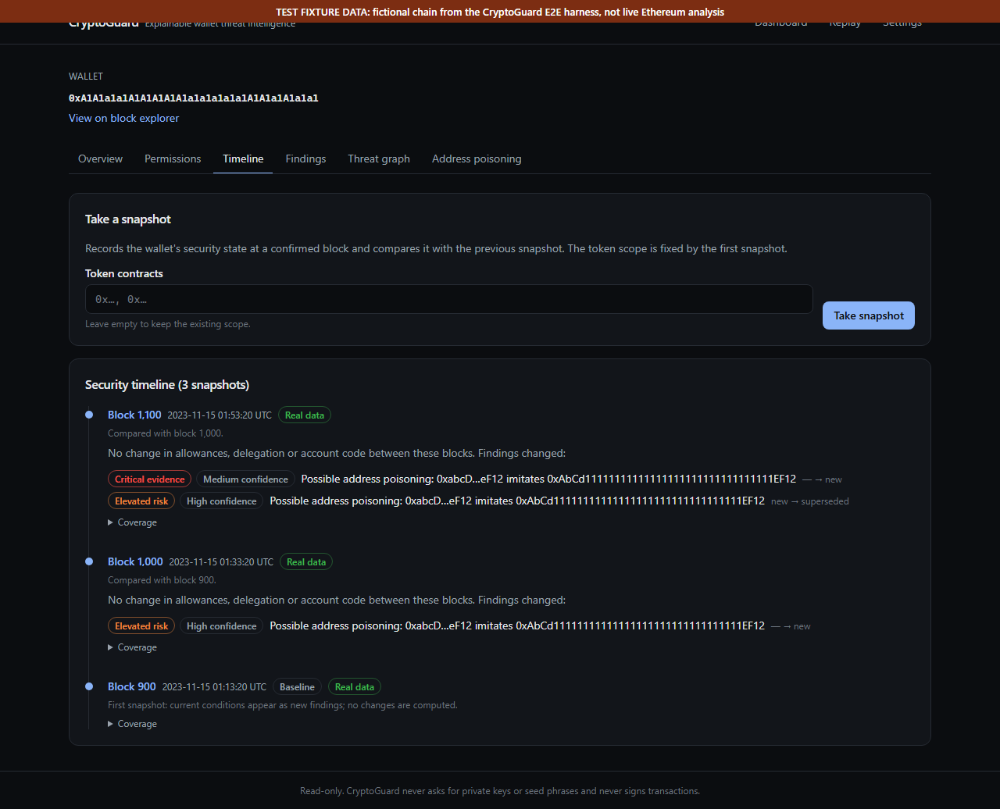

# CryptoGuard — Explainable Wallet Threat Intelligence

[](https://github.com/Apostal322/CryptoGuard/actions/workflows/ci.yml)

CryptoGuard is a **read-only** security analysis tool for Ethereum wallets. It shows what is
observably true about an address, the block that observation comes from, and what the
observation does *not* show. It never asks for private keys, seed phrases or signatures, and
it has no code path that signs or broadcasts transactions.

> **Status: 0.1.0 release candidate (pre-release).** Not independently audited; do not use it
> as the only safeguard for funds. Experimental analyses are off by default. ML is deliberately
> not implemented (see [Roadmap](#roadmap)). Evaluation: [EVALUATION.md](EVALUATION.md),
> [CAMPAIGN_EVALUATION.md](CAMPAIGN_EVALUATION.md). Release status:
> [RELEASE_CANDIDATE_REPORT.md](RELEASE_CANDIDATE_REPORT.md).

| Security finding with evidence | Security timeline |
|---|---|
|  |  |

*Screenshots from the browser E2E suite: the real frontend and API, connected to a
**fictional** test chain. Every address, transaction and block in them is made up (each
image carries a banner). More in [docs/screenshots](docs/screenshots/README.md).*

## How it works

```
Ethereum JSON-RPC (your provider) ──► hardened RPC client (chain check, block pinning, budgets)
        │
        ▼
services: inspection · approvals · transfers · wallet-signed txs (nonce search) · snapshots
        │                                         │
        ▼                                         ▼
pure detectors + versioned rules ──► findings with evidence, lifecycle, timeline (SQLite)
        │
        ├─► FastAPI /api/v1 (local, read-only) ──► React UI (apps/web)
        └─► CLI; offline incident replay from recorded fixtures (no RPC)
```

Everything shown is derived from observations at a named block; a finding carries the
transactions and state reads that support it. Experimental analyses (graph, spectral,
temporal, cross-wallet campaigns) run only in *shadow mode* and never create findings.
Details: [ARCHITECTURE.md](ARCHITECTURE.md), [DETECTION_METHODS.md](DETECTION_METHODS.md).

## Historical evaluation at a glance

Four recorded mainnet address-poisoning thefts are replayed offline at every block before the
theft, seeing only data available at that block ([EVALUATION.md](EVALUATION.md)). With the
wallet's own signed transactions visible, the detector warned on the address that later
received the funds **367, 42, 113 and 13,057 blocks** before the theft (about 74 min, 8 min,
22 min and 44 h). With ERC-20 data alone, two of the four were not detected. Four cases are
case studies, not an accuracy estimate: no detection rate, false-positive rate or
generalization is claimed. Cross-wallet campaign analysis found real shared planting
infrastructure across wallets, but no earlier warning than the existing detector and no
evidence of common ownership ([CAMPAIGN_EVALUATION.md](CAMPAIGN_EVALUATION.md)).

## What works today

| Capability | Status |
|---|---|
| Point-in-time address inspection: verified chain id, block number/hash/time, finality, native balance, account code | Implemented |
| EIP-7702 delegation detection (exact `0xef0100 ‖ address`, 23 bytes) plus the delegate's code type | Implemented |
| Hardened JSON-RPC provider: chain verification, bounded retries with jitter, `Retry-After`, timeouts, response size cap, strict validation | Implemented |
| Reorg-safe reads: all state pinned to one block and re-checked against that block's hash | Implemented |
| Idempotent observation storage (SQLite; PostgreSQL via `DATABASE_URL`) | Implemented |
| REST API (`/api/v1`) with rate limiting, body-size limit, restricted CORS, safe errors | Implemented |
| ERC-20 approval discovery from `Approval` logs in a bounded block window (newest-first, adaptive splitting, request budget, optional token scope) | Implemented |
| Current-state verification: `allowance()`, `balanceOf()`, `decimals()`, `symbol()` and spender code at one pinned block | Implemented |
| Exposure upper bound `min(balance, allowance)`, unlimited/effectively-unlimited detection, evidence-classed signals | Implemented |
| ERC-721-shaped `Approval` logs recognized and kept apart from fungible allowances | Implemented (NFT approvals not analyzed) |
| Wallet security snapshots at a confirmed block, with incremental (checkpointed) approval discovery and cumulative coverage including explicit gaps | Implemented |
| Deterministic deltas between snapshots (allowance granted/increased/reduced/revoked/unverifiable, delegation set/changed/cleared), each located between two blocks and tied to a transaction only when an observed event explains it | Implemented |
| Versioned rule engine (`cg-rules` 1.0.0) with separate severity and confidence, deterministic finding fingerprints | Implemented |
| Finding lifecycle: new → active → acknowledged → resolved / superseded, reopen, audit trail; never resolved on unverifiable data | Implemented |
| Reorg handling for history: orphaned snapshots detected, marked and rebased | Implemented |
| ERC-20 transfer discovery (both directions) with bounded transaction-signer lookups, stored per wallet | Implemented |
| Address-poisoning detector: full-address prefix/suffix similarity, zero-value / spoofed / unsolicited transfer context, wallet-sent-to-lookalike evidence, configurable thresholds, false-positive guards | Implemented |
| Detector framework (pure, versioned detectors merged into the finding lifecycle) | Implemented |
| CLI (`inspect`, `approvals`, `poisoning`, `snapshot`, `timeline`, `findings`, `ack`, `status`, `serve`, `purge`, `demo-addresses`) | Implemented |
| Explicit demo mode with clearly labelled fictional fixtures | Implemented |
| Web UI (`apps/web`): dashboard, wallet overview, permission inspector, security timeline, findings with evidence and acknowledgement, address-poisoning view, settings; demo/real labelling and loading, empty, partial-coverage and error states | Implemented |
| Threat graph: typed edges (approved spender, holds token, delegates to, transfers in/out, resembles) built from stored observations, each with its evidence; only similarity edges are inferred; node and approval limits with an explicit summary node; interactive Cytoscape view plus an accessible list | Implemented |
| Historical incident replay: publicly sourced manifests, recorded mainnet fixtures, offline point-in-time engine with leakage checks, generated [EVALUATION.md](EVALUATION.md), Replay page in the UI | Implemented (4 cases, plus 9 sampled background wallets) |
| Cross-wallet poisoning campaign analysis: canonical attempts, planting-side relationship evidence (shared planting transaction, verified signer, lookalike), conservative clustering with hub and transitivity guards, budgeted resumable expansion around planting signers and lookalikes, read-only API and UI section ([CAMPAIGN_EVALUATION.md](CAMPAIGN_EVALUATION.md)) | Experimental, **off by default** (shadow mode): real cross-wallet links found, no earlier theft warning than the existing detector |
| Network, structural and activity-rate analyses (graph propagation, spectral features, robust burst statistics) over stored observations, coverage-aware and point in time | Experimental, **off by default**: evaluated with no measurable gain over the existing detector; available in shadow mode only (see [DETECTION_METHODS.md](DETECTION_METHODS.md)) |
| Wallet-signed transactions (incl. native-ETH payments) located by nonce search in snapshots and scans; used by the poisoning detector and the graph; degrades to explicit "unlocated" counts without archive state | Implemented |
| Scheduled monitoring loop, native ETH *received*, NFT/Permit2 approvals, ML | Not yet |

## Quick start

**Requirements:** [uv](https://docs.astral.sh/uv/) (it installs Python 3.12 if missing) and,
for the web UI, Node.js 22 or newer (tested with 24). Light on memory: the heaviest bundled
workload (the full analytics evaluation) peaked at about 200 MiB. **Platforms:** CI runs the backend,
frontend and package checks on Windows and Ubuntu (Python 3.12; 3.13 too on Ubuntu) and the
browser tests on Ubuntu; development happened on Windows 11. macOS is untested.

```powershell
# Windows PowerShell (verified)
git clone https://github.com/Apostal322/CryptoGuard.git cryptoguard; cd cryptoguard
uv sync                          # backend; add --extra analytics for the experimental analyses
uv run cryptoguard serve --demo  # API on http://127.0.0.1:8000 with fictional demo data
# second terminal:
cd apps/web; npm ci; npm run dev # UI on http://127.0.0.1:3000
```

```bash
# Linux / macOS (CI runs the same install steps on Ubuntu; macOS untested)
git clone https://github.com/Apostal322/CryptoGuard.git cryptoguard && cd cryptoguard
uv sync
uv run cryptoguard serve --demo &
cd apps/web && npm ci && npm run dev
```

**Real Ethereum data:** copy `.env.example` to `.env`, set `CRYPTOGUARD_RPC_URL` (your own
provider; public endpoints are rate-limited and many lack historical state), and start
`uv run cryptoguard serve` without `--demo`. Data is stored in `data/cryptoguard.db`; the
schema is created and migrated automatically on start.

### Troubleshooting

| Symptom | Cause and fix |
|---|---|
| UI shows "The CryptoGuard API is unreachable" | Start the backend (`uv run cryptoguard serve`) on port 8000, or set `CRYPTOGUARD_API_URL` for `npm run dev`. |
| `rpc_not_configured` | Real mode needs `CRYPTOGUARD_RPC_URL`; use `--demo` to try the app without one. |
| `historical_state_unavailable`, "unlocated" transactions | The provider prunes old state. Results say what was not covered; use an archive-capable provider for full history. |
| `log_filter_restricted` | The provider refuses wallet-wide log queries; name token contracts (`--token`) or switch provider. |
| `invalid_host` (400) | The API only answers to `127.0.0.1`, `localhost`, `::1`; add a hostname to `CRYPTOGUARD_ALLOWED_HOSTS` only if you deliberately serve it. |
| `origin_not_allowed` (403) / `unsupported_media_type` (415) | Cross-site or non-JSON POSTs are refused by design (CSRF protection). |
| `snapshot_in_progress` / `campaign_run_in_progress` (409) | One run per wallet (or per campaign analysis) at a time, across processes; retry when it finishes. |
| `schema_mismatch` on start | The database was changed by another version; back it up, then run a matching version or purge. |

## Configure

All settings are environment variables (or `.env`) with the `CRYPTOGUARD_` prefix; see
[.env.example](.env.example). The important ones:

- `CRYPTOGUARD_MODE` — `real` (default) or `demo`. Real mode **never** falls back to demo data:
  without an RPC URL, inspections fail with `rpc_not_configured`.
- `CRYPTOGUARD_RPC_URL` — HTTPS JSON-RPC endpoint (plain HTTP only for `localhost`). It is
  operator configuration only; the API never accepts an RPC URL from a request. It is redacted
  to `scheme://host/…` everywhere it is displayed and scrubbed from logs.
- `CRYPTOGUARD_CHAIN_ID` — `1` (mainnet) or `11155111` (Sepolia). Every session first checks
  `eth_chainId` and refuses to read state from a different chain.
- `CRYPTOGUARD_ANALYSIS_GRAPH`, `CRYPTOGUARD_ANALYSIS_SPECTRAL`, `CRYPTOGUARD_ANALYSIS_TEMPORAL`
  — `off` (default) or `shadow`. Shadow mode computes the experimental analyses from stored
  data for review only; they never create findings. They need the optional extra:
  `uv sync --extra analytics`.
- `CRYPTOGUARD_ALLOWED_HOSTS` — hostnames the API answers to (default `127.0.0.1`,
  `localhost`, `::1`); other `Host` headers are refused, which blocks DNS-rebinding attacks.
  The API has no authentication and is meant for one local user.
- `CRYPTOGUARD_OPERATION_LEASE_SECONDS` — lifetime (default 900) of the database lease that
  makes snapshots per wallet and campaign runs single-flight across processes.
- `CRYPTOGUARD_CAMPAIGN_ANALYSIS` — `off` (default) or `shadow`: groups poisoning attempts of
  all monitored wallets that share planting infrastructure ("potentially related poisoning
  activity"). Read-only context; never findings, never ownership claims.

### RPC provider limitations

- `ethereum-rpc.publicnode.com` (checked 2026-10-24) serves recent data only; historical
  ("archive") log and state queries need a personal token. `eth.drpc.org`'s free plan serves
  historical logs and state but limits `eth_getLogs` to about 100 blocks per request;
  CryptoGuard splits larger queries automatically.

- Free/public endpoints rate-limit aggressively; CryptoGuard retries with backoff, but heavy
  use needs a keyed provider.
- Many endpoints prune old state. Reading state at old blocks needs an archive node; such
  failures are reported as `historical_state_unavailable`, never as a zero balance.
- Standard JSON-RPC cannot list every transaction of an address. Inspections are single
  snapshots, and approval scans cover only the block window they report.
- Some free endpoints refuse `eth_getLogs` without a contract `address` filter (for example
  `ethereum-rpc.publicnode.com`, checked 2026-10-23). There, wallet-wide approval discovery
  fails with `log_filter_restricted`; pass `--token <contract>` (API: `tokens`) to scan named
  tokens, or use a provider that allows wallet-wide log queries.
- Your RPC provider sees which addresses you inspect. Run your own node if that matters.

## Use

```powershell
uv run cryptoguard status
uv run cryptoguard inspect 0xC02aaA39b223FE8D0A0e5C4F27eAD9083C756Cc2
uv run cryptoguard inspect <address> --json

# ERC-20 approvals granted in the last 10,000 blocks (default), verified at the head block
uv run cryptoguard approvals <address>
uv run cryptoguard approvals <address> --lookback 50000
uv run cryptoguard approvals <address> --token 0xA0b86991c6218b36c1d19D4a2e9Eb0cE3606eB48

# Address poisoning: one-off scan of recent ERC-20 transfers (nothing stored).
# Snapshots run the same detector over the wallet's stored transfer history.
uv run cryptoguard poisoning <address> --lookback 5000

# Security timeline: each snapshot is compared with the previous one
uv run cryptoguard snapshot <address>            # first run = baseline
uv run cryptoguard snapshot <address>            # later runs list what changed and why
uv run cryptoguard timeline <address>
uv run cryptoguard findings <address> [--all]
uv run cryptoguard ack <finding-id>
uv run cryptoguard graph <address>             # relationships from the latest snapshot

# Historical incident replay (offline, from packaged fixtures)
uv run cryptoguard replay list
uv run cryptoguard replay run --write-report EVALUATION.md
# Re-record a fixture (needs historical logs + state, e.g. https://eth.drpc.org):
uv run cryptoguard replay record <case-id> --rpc-url <archive-capable RPC>
# Evaluate the experimental analyses too (incidents + background wallets; analytics extra):
uv run --extra analytics cryptoguard replay run --analytics --write-report EVALUATION.md
# Background wallets: seeded random sample, then record their fixtures
uv run cryptoguard replay sample-background --rpc-url <RPC> --seed <n> --from-block <a> --to-block <b>
uv run cryptoguard replay record-background --rpc-url <RPC>

# Cross-wallet campaigns (CRYPTOGUARD_CAMPAIGN_ANALYSIS=shadow)
uv run cryptoguard campaigns analyze                 # cluster stored attempts, no RPC calls
uv run cryptoguard campaigns expand --max-requests 300   # budgeted, resumable, uses the RPC
# Research: record expansion around the replay fixtures, then evaluate offline
uv run cryptoguard campaigns record-expansion --rpc-url <archive-capable RPC>
uv run --extra analytics cryptoguard campaigns evaluate --write-report CAMPAIGN_EVALUATION.md

# Fictional fixtures, no RPC needed (output is labelled SIMULATED):
uv run cryptoguard demo-addresses
uv run cryptoguard inspect <fixture-address> --demo

# HTTP API on http://127.0.0.1:8000 (OpenAPI docs at /docs)
uv run cryptoguard serve

# Delete locally stored observations
uv run cryptoguard purge --yes
```

API:

| Method | Path | Purpose |
|---|---|---|
| GET | `/api/v1/health` | Liveness and database check |
| GET | `/api/v1/status` | Mode, redacted provider, chain verification, head block, RPC metrics |
| POST | `/api/v1/analyze/address` | `{"address": "0x…"}` → inspection (persisted idempotently) |
| POST | `/api/v1/wallets/{address}/approvals/scan` | `{"lookback_blocks"?, "from_block"?, "tokens"?}` → approval scan report (send `{}` for defaults) |
| GET | `/api/v1/wallets/{address}/approvals` | Latest stored approval scan (404 if none) |
| POST | `/api/v1/wallets/{address}/snapshots` | `{"block"?, "tokens"?, "lookback_blocks"?}` → snapshot with changes and finding transitions |
| GET | `/api/v1/wallets/{address}/timeline` | Snapshots newest first with deltas, finding events, coverage (`limit`, `offset`, `include_orphaned`) |
| GET | `/api/v1/wallets/{address}/findings` | Findings (`status=open` default, `all`, or a single status) |
| GET | `/api/v1/findings/{finding_id}` | Finding with evidence and full transition history |
| POST | `/api/v1/findings/{finding_id}/acknowledge` | Mark a new/active finding acknowledged (`{}` body) |
| GET | `/api/v1/wallets/{address}/graph` | Relationship graph from the latest snapshot (`max_nodes` 10–150, `include_inactive`); every edge has evidence; no RPC calls |
| POST | `/api/v1/wallets/{address}/poisoning/scan` | `{"lookback_blocks"?, "tokens"?}` → poisoning cases with similarity features, signals and evidence |
| GET | `/api/v1/replay/cases` | Packaged incident cases (manifest, sources, fixture hash) |
| POST | `/api/v1/replay/runs` | `{"case_id"}` → offline point-in-time replay result (not stored; no RPC) |
| GET | `/api/v1/rules` | The ruleset: id, version, severities, rule descriptions |
| GET | `/api/v1/wallets/{address}/analysis` | Experimental network/activity/structure context (`CRYPTOGUARD_ANALYSIS_*=shadow`); sections report `disabled` by default |
| POST | `/api/v1/campaigns/runs` | Experimental: cluster stored poisoning attempts of all monitored wallets (`{}` body; no RPC; one run at a time) |
| GET | `/api/v1/campaigns` | Candidate clusters of the latest run (`limit`, `offset`) |
| GET | `/api/v1/campaigns/{campaign_id}` | Cluster detail: evidence with strengths, joining points, member attempts (`limit`) |
| GET | `/api/v1/campaigns/{campaign_id}/graph` | Typed campaign graph, attempts as nodes (`max_attempts` 1–500) |
| GET | `/api/v1/wallets/{address}/related-activity` | Clusters that include this wallet's attempts; campaign endpoints answer 409 `feature_disabled` unless `CRYPTOGUARD_CAMPAIGN_ANALYSIS=shadow` |
| GET | `/api/v1/wallets/{address}/observations` | Stored observations, paginated (`limit`, `offset`) |
| GET | `/api/v1/demo/addresses` | Fixture addresses (demo mode only) |

Every inspection carries `data_source` (`rpc` / `demo_fixture`), `simulated`, the exact block
it describes, `coverage` and an explicit list of `limitations`.

## Web UI

Requires Node.js 22+ (tested with 24). The UI is a static React app; in development Vite
proxies `/api` to the backend on `127.0.0.1:8000`, so no CORS change is needed.

```powershell
uv run cryptoguard serve            # terminal 1 (add --demo for simulated data)
cd apps/web; npm ci; npm run dev    # terminal 2, then open http://127.0.0.1:3000
```

`npm run build` writes `apps/web/dist/` with a strict Content-Security-Policy. Serve it from
the same origin as the API (any static server or reverse proxy that forwards `/api` and keeps
the `Host` header, which the API checks). `npx vite preview` does this for local use.
Screenshots (fixture data): [docs/screenshots](docs/screenshots/README.md).

## Test

```powershell
.\scripts\check.ps1           # everything CI runs, locally (Windows); -SkipE2E to skip browsers
# or step by step:
uv run pytest                 # offline suite (fake JSON-RPC node, no network)
uv run ruff check .
uv run mypy src
cd apps/web; npm run typecheck; npm test; npm run build

# Browser end-to-end tests (Playwright, headless Chromium; one-time: npx playwright install chromium).
# They start the real backend against a fictional test chain plus the production UI build,
# each profile with its own temporary database. Headed: npx playwright test --headed
cd apps/web; npm run e2e

# Opt-in live test against a real mainnet endpoint:
$env:CRYPTOGUARD_LIVE_RPC_URL = "https://ethereum-rpc.publicnode.com"; uv run pytest -m live
```

On Linux/macOS, `scripts/check.sh` is the equivalent. CI runs the same steps as separate jobs on
Ubuntu and Windows (`.github/workflows/ci.yml`) and lints `check.sh` with shellcheck.

## Security model

- **Read-only.** No private keys, seed phrases or signatures are ever requested; there is no
  code path that signs or broadcasts a transaction.
- **Local, single user.** The API binds to `127.0.0.1` and has no authentication. It refuses
  foreign `Host` headers (DNS rebinding), foreign `Origin`s and non-JSON POSTs (CSRF), and
  limits body size and request rate. Expose it only behind an authenticating proxy.
- **Untrusted chain data.** Token names and symbols are rendered as text, never HTML; the RPC
  URL comes only from operator configuration and is redacted everywhere it is shown.
- **Consistency.** Snapshots per wallet and campaign runs are single-flight across processes
  (database leases with fencing); schema changes are versioned, transactional migrations.

See [SECURITY.md](SECURITY.md) for reporting and the threat model.

## Limitations

- Standard JSON-RPC cannot list all of an address's activity: native ETH *received*,
  internal transfers and funding sources are not visible; approval and transfer scans cover
  the block window they report.
- Non-archive providers lack historical state; affected results say what was not covered.
- Detection is evaluated on four incidents only. It will miss attacks it has no rule for, and
  a quiet result is never a safety verdict.
- The experimental analyses showed no gain over the existing detector and stay off by
  default; campaign groups are candidate links, never attribution.
- Tested on SQLite. PostgreSQL is supported through SQLAlchemy but has not been tested.
- Not independently audited.

## Roadmap

1. ~~Backend foundation~~
2. ~~ERC-20 approval discovery and allowance verification~~
3. ~~Wallet security timeline: snapshots, deterministic deltas, finding lifecycle~~ (a
   scheduled monitoring loop is still to come)
4. ~~Address-poisoning detector with false-positive fixtures~~
5. ~~Web UI (Vite, React, TypeScript, Tailwind)~~
6. ~~Threat graph~~
7. ~~Historical incident replay with point-in-time guarantees~~ (4 incidents, 9 background
   wallets; more needed before any rate can be estimated). Experimental graph, spectral,
   temporal and cross-wallet campaign analyses were evaluated on top; none is enabled by
   default ([EVALUATION.md](EVALUATION.md), [CAMPAIGN_EVALUATION.md](CAMPAIGN_EVALUATION.md)).
8. **Machine learning: deferred, deliberately.** The brief allows ML only once enough data
   exists. It does not: 4 labelled thefts, 9 unlabelled background wallets, and no
   independent labels for attempts or campaigns. Any classifier trained here would either
   overfit 4 positives or learn to imitate CryptoGuard's own rules (circular). Revisit when a
   labelled, time-split dataset exists that a deterministic baseline can be measured on.
9. ~~Release quality~~: security, dependency, reproducibility and packaging review (see
   [CHANGELOG.md](CHANGELOG.md)). Not independently audited.

See [ARCHITECTURE.md](ARCHITECTURE.md), [DETECTION_METHODS.md](DETECTION_METHODS.md) and
[SECURITY.md](SECURITY.md).

## License

MIT, see [LICENSE](LICENSE).
